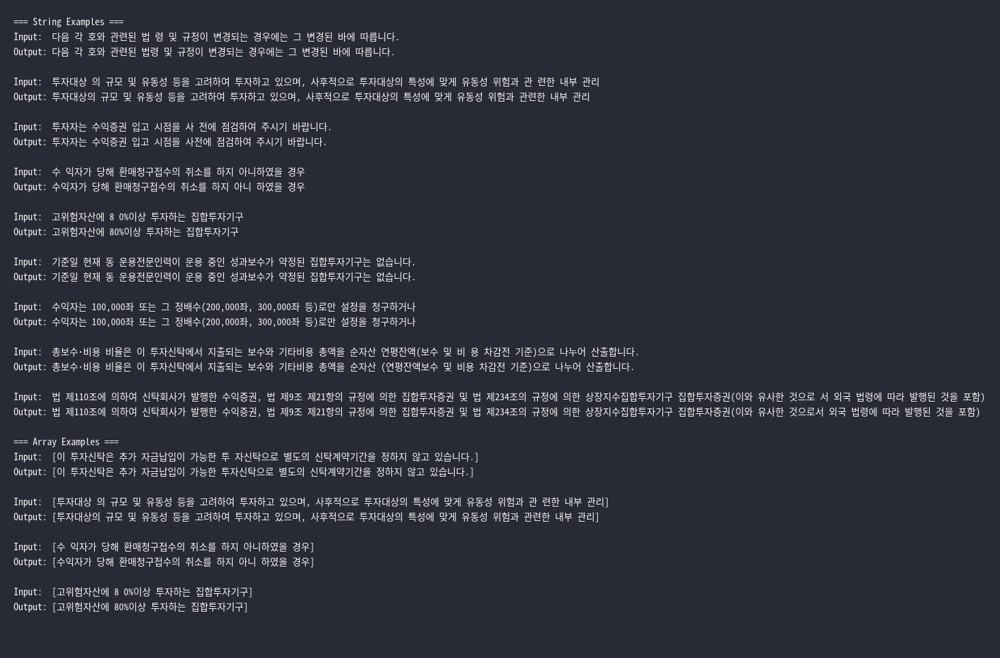

* kolangfine
Kiwi 형태소 분석기를 활용한 한국어 띄어쓰기 교정 도구 테스트

** 요구사항
- Go 1.21 이상

** 의존성
- [[https://github.com/codingpot/kiwigo][kiwigo]] - Kiwi 형태소 분석기 Go 바인딩

** 사전 설치
#+begin_src bash
  # kiwi 설치
  make install-kiwi

  # 모델 설치
  make install-model
#+end_src

** 설치 및 실행
#+begin_src shell
  make build
  ./kolangfine
#+end_src

** 실행결과

#+begin_src fundamental
  go run ./main.go
=== String Examples ===
Input:  다음 각 호와 관련된 법 령 및 규정이 변경되는 경우에는 그 변경된 바에 따릅니다.
Output: 다음 각 호와 관련된 법령 및 규정이 변경되는 경우에는 그 변경된 바에 따릅니다.

Input:  투자대상 의 규모 및 유동성 등을 고려하여 투자하고 있으며, 사후적으로 투자대상의 특성에 맞게 유동성 위험과 관 련한 내부 관리
Output: 투자대상의 규모 및 유동성 등을 고려하여 투자하고 있으며, 사후적으로 투자대상의 특성에 맞게 유동성 위험과 관련한 내부 관리

Input:  투자자는 수익증권 입고 시점을 사 전에 점검하여 주시기 바랍니다.
Output: 투자자는 수익증권 입고 시점을 사전에 점검하여 주시기 바랍니다.

Input:  수 익자가 당해 환매청구접수의 취소를 하지 아니하였을 경우
Output: 수익자가 당해 환매청구접수의 취소를 하지 아니 하였을 경우

Input:  고위험자산에 8 0%이상 투자하는 집합투자기구
Output: 고위험자산에 80%이상 투자하는 집합투자기구

Input:  기준일 현재 동 운용전문인력이 운용 중인 성과보수가 약정된 집합투자기구는 없습니다.
Output: 기준일 현재 동 운용전문인력이 운용 중인 성과보수가 약정된 집합투자기구는 없습니다.

Input:  수익자는 100,000좌 또는 그 정배수(200,000좌, 300,000좌 등)로만 설정을 청구하거나
Output: 수익자는 100,000좌 또는 그 정배수(200,000좌, 300,000좌 등)로만 설정을 청구하거나

Input:  총보수･비용 비율은 이 투자신탁에서 지출되는 보수와 기타비용 총액을 순자산 연평잔액(보수 및 비 용 차감전 기준)으로 나누어 산출합니다.
Output: 총보수･비용 비율은 이 투자신탁에서 지출되는 보수와 기타비용 총액을 순자산 (연평잔액보수 및 비용 차감전 기준)으로 나누어 산출합니다.

Input:  법 제110조에 의하여 신탁회사가 발행한 수익증권, 법 제9조 제21항의 규정에 의한 집합투자증권 및 법 제234조의 규정에 의한 상장지수집합투자기구 집합투자증권(이와 유사한 것으로 서 외국 법령에 따라 발행된 것을 포함)
Output: 법 제110조에 의하여 신탁회사가 발행한 수익증권, 법 제9조 제21항의 규정에 의한 집합투자증권 및 법 제234조의 규정에 의한 상장지수집합투자기구 집합투자증권(이와 유사한 것으로서 외국 법령에 따라 발행된 것을 포함)

=== Array Examples ===
Input:  [이 투자신탁은 추가 자금납입이 가능한 투 자신탁으로 별도의 신탁계약기간을 정하지 않고 있습니다.]
Output: [이 투자신탁은 추가 자금납입이 가능한 투자신탁으로 별도의 신탁계약기간을 정하지 않고 있습니다.]

Input:  [투자대상 의 규모 및 유동성 등을 고려하여 투자하고 있으며, 사후적으로 투자대상의 특성에 맞게 유동성 위험과 관 련한 내부 관리]
Output: [투자대상의 규모 및 유동성 등을 고려하여 투자하고 있으며, 사후적으로 투자대상의 특성에 맞게 유동성 위험과 관련한 내부 관리]

Input:  [수 익자가 당해 환매청구접수의 취소를 하지 아니하였을 경우]
Output: [수익자가 당해 환매청구접수의 취소를 하지 아니 하였을 경우]

Input:  [고위험자산에 8 0%이상 투자하는 집합투자기구]
Output: [고위험자산에 80%이상 투자하는 집합투자기구]
#+end_src
